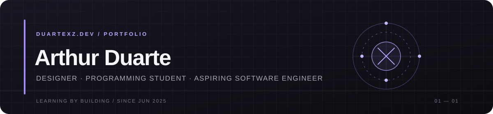

  

  <a href="https://github.com/duartexz-dev">GitHub</a>
  &nbsp;·&nbsp;
  <a href="https://www.youtube.com/@duarteeo-dev">YouTube</a>
  &nbsp;·&nbsp;
  <a href="https://www.instagram.com/duarteeo.dev/">Instagram</a>

## About

I'm a Brazilian designer and programming student interested in software development and thoughtful digital experiences. Since **June 2025**, I've been learning by building projects, testing ideas, and documenting what I discover.

My current focus is **Java**, **object-oriented programming**, and strengthening my **JavaScript** fundamentals.

## Selected work

| Project | Overview |
| --- | --- |
| [BuildJava.ln](https://github.com/duartexz-dev/BuildJava.ln) | A practical Java learning path with original exercises, study guides, and a catalogue that tracks real progress. |
| [agentes.code](https://github.com/duartexz-dev/agentes.code) | A GitHub Actions workflow that collects and organizes Copilot agent definitions from my repositories. |
| [Avocrypto](https://github.com/duartexz-dev/Avocrypto) | A cryptocurrency dashboard that consumes the CoinGecko API to display market data, rankings, and news. |

## Technologies

**Languages and web**

**Tools**

---

  Learning by building · Since June 2025

